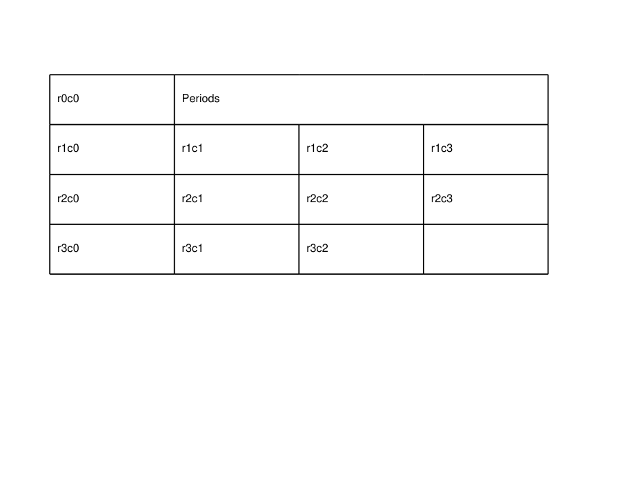
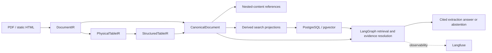

# Document Agent

**Table-aware document understanding and evidence-grounded RAG.**

PDF의 본문과 복합표를 원본 근거와 함께 구조화하고, 행·열 경로를 따라 실제 셀을 조회하는 Document AI 프로젝트입니다.

This project explores a practical problem: retrieving the right document is not enough when an answer depends on merged headers, row groups, nested tables, and the relationship between a value and its source cell.

It combines PDF structure reconstruction, typed document contracts, PostgreSQL/pgvector retrieval, and a bounded LangGraph answer workflow. It preserves uncertain interpretations instead of silently turning them into verified facts.

**Status:** locally executed research/MVP prototype. This repository contains runtime source and a reproducible synthetic demo. It is not a deployed service or a claim of universal PDF accuracy.

## What I built

- Evidence-preserving extraction with original text, coordinates, page identifiers, and source references.
- Physical table reconstruction including merged cells, stroke/fill boundaries, and candidate row/column hierarchies.
- Conditional nested-table separation and parent-cell links using source spans and geometry.
- A CanonicalDocument assembly that keeps text, tables, context, and source references together.
- Derived search projections for PostgreSQL keyword search and pgvector experiments. Original JSON remains the source of truth.
- A LangGraph workflow that retrieves, resolves cells, validates available evidence, and invokes GPT-4.1 for bounded evidence selection with deterministic cited rendering.
- Langfuse instrumentation, abstention behavior, and regression/generalization experiments.

The strongest engineering focus is traceability: a retrieved result can be followed back to a document, table, row/column path, and original cell.

## Try the offline demo

Python 3.11+ is required. The included PDF is synthetic; no bank documents, account credentials, or model API calls are needed.

```sh
python -m venv .venv
# Windows: .venv\Scripts\Activate.ps1
# macOS/Linux: source .venv/bin/activate
python -m pip install ".[dev]"
python examples/demo.py
python examples/inspect_document.py --output demo-output
python -m pytest -q
```

The geometry demo checks one page, one table, 14 physical cells, and a three-column merged header. The inspection demo writes the actual CanonicalDocument, search projections, nested-content sidecar, and source-linked cell candidates. It does **not** simulate a successful GPT answer or approve semantic relationships.



## How the system works



The vector index stores embeddings of derived search text, not the entire JSON as a replacement for its structure. Search retrieves candidates; source identifiers and Tree paths support exact cell lookup afterward. Long narrative cells and arbitrary nested layouts remain active areas of work.

## Evidence from actual experiments

These are development/local evaluation results, not independent benchmark scores:

| Experiment | Observed result | Interpretation |
|---|---|---|
| Initial batch | 25 documents stored and reloaded; 21 native extractions, 4 OCR-required | Storage success is not extraction completeness |
| Retrieval comparison | On 37 answerable development questions: keyword 27, table-vector 14, vector+Tree 32, hybrid+Tree 32, keyword+Tree 32 cell-exact matches | Tree lookup mattered; no claim that vectors always improve retrieval |
| Repeated-panel development case | Correct value + both paths: 3/5 → 5/5 | Fixed right-panel values attached to left-panel labels |
| New Hana document after code freeze | 3/6 → 6/6 | Positive result, but same publisher/layout family |
| New Woori document after freeze | 3/6 → 3/6 | Central double ruling created an extra physical column |
| New KB document after freeze | 0/10 → 0/10 | Merged superheaders and overprinted native text remain unresolved |
| Selected private-workspace regression suite | 97 tests passed; 373 HSBC/NH physical cells and existing paths preserved | Separate from the included public synthetic test suite |

Read [evaluation scope and limitations](docs/EVALUATION.md) before interpreting these numbers. The original document corpus and private evaluation artifacts are not bundled. Correctly matched but unapproved semantic candidates remain marked as uncertain.

## Code guide

| Area | Entry point |
|---|---|
| Document contracts | [domain/models.py](src/doc_understanding/domain/models.py), [domain/pipeline_contracts.py](src/doc_understanding/domain/pipeline_contracts.py) |
| Physical reconstruction | [physical_grid.py](src/doc_understanding/table_understanding/physical_grid.py) |
| Stroke/fill boundary evidence | [fill_boundaries.py](src/doc_understanding/physical_experiment/fill_boundaries.py) |
| Nested region separation | [nested_regions.py](src/doc_understanding/table_understanding/nested_regions.py) |
| Semantic candidates and repeated panels | [semantic.py](src/doc_understanding/table_understanding/semantic.py), [repeated_panels.py](src/doc_understanding/table_understanding/repeated_panels.py) |
| Document assembly / nested links | [document.py](src/doc_understanding/document_rag/document.py), [nested_content.py](src/doc_understanding/document_rag/nested_content.py) |
| Search projections / SQL | [index.py](src/doc_understanding/document_rag/index.py), [repository.py](src/doc_understanding/document_rag/repository.py) |
| Vector / hybrid experiments | [retrieval_experiment](src/doc_understanding/retrieval_experiment) |
| Graph / answer generation | [graph.py](src/doc_understanding/document_rag/graph.py), [answer.py](src/doc_understanding/document_rag/answer.py) |

The source snapshot also contains experimental adapters and local review utilities. Their presence does not mean every module is a supported public service. [Reproduction notes](docs/REPRODUCTION.md) distinguish the offline demo from the configured database/model workflow.

## Design decisions and remaining work

- Keep raw evidence separate from inferred structure and reviewed truth.
- Compare extraction errors separately from retrieval errors.
- Freeze code before new-source evaluation; retain failures in the denominator.
- Use source spans and coordinates for containment; do not match by document name.
- Bound retries and model calls; preserve blank, zero, negative signs, and ambiguous paths.

Current limitations include headerless row groups, double-line boundaries, merged-header panels, overprinted text, and full long-cell/nested-content retrieval coverage. OCR/VLM handling of arbitrary scanned documents is not demonstrated. No financial facts are automatically approved or published.

## Project identity and release scope

The working project originated as **NH Document Understanding**. The internal Python package remains `doc_understanding`; the portfolio title is **Document Agent**. The title does not imply affiliation with a financial institution.

This repository is a curated source portfolio with a synthetic demonstration. Original PDFs, local settings, trace credentials, and private evaluation data are excluded. A project-wide open-source license has not been selected; no MIT/Apache grant is implied. Third-party dependency terms still apply.

## Short project description

> Built a table-aware document understanding and RAG prototype that preserves PDF evidence, reconstructs complex table structures, links nested tables, and resolves source cells through PostgreSQL/pgvector and LangGraph. Evaluated extraction, retrieval, and semantic mapping separately, retaining uncertainty and failed holdout cases rather than reporting storage or test success as document accuracy.
