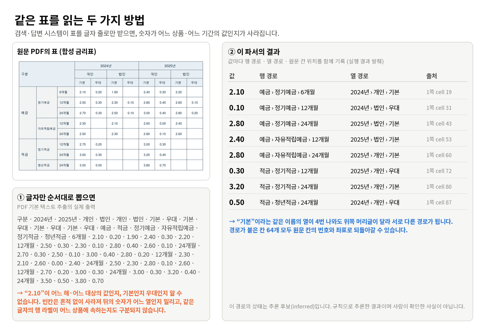
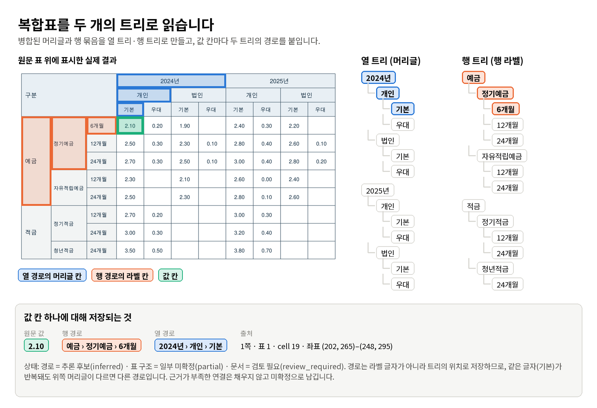
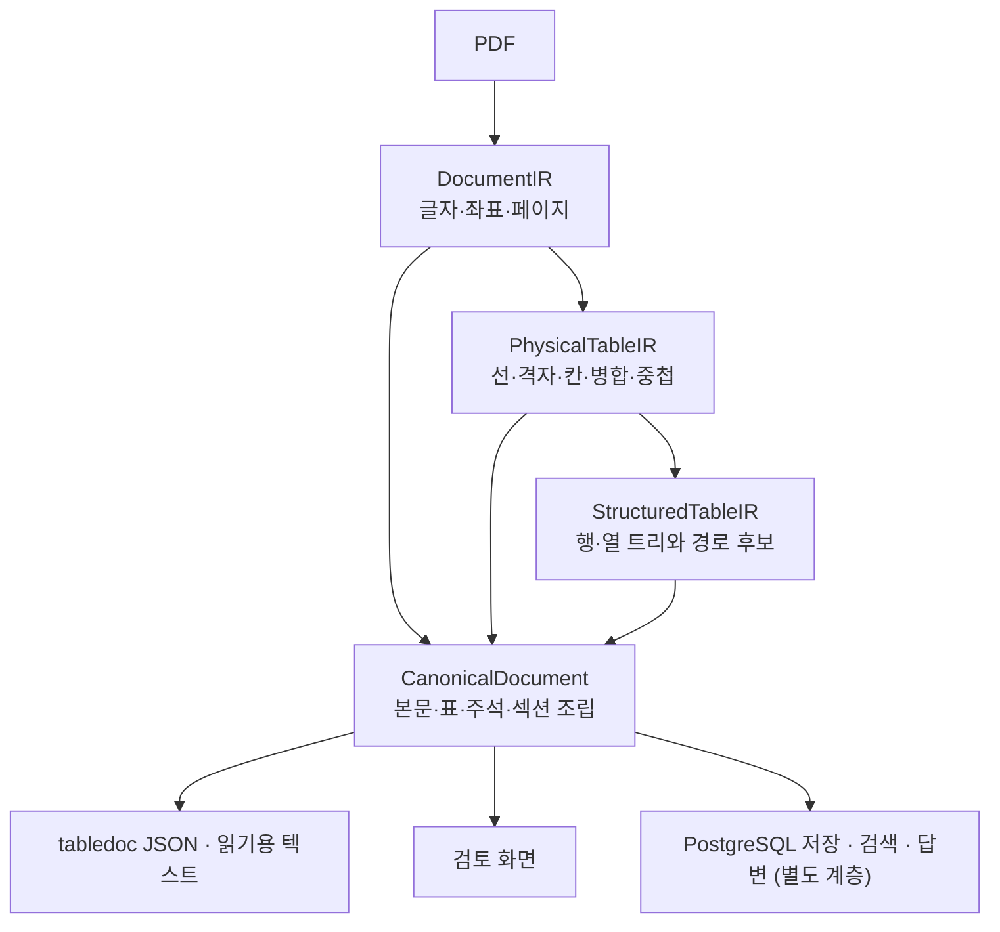

# Document Agent

**복합표가 있는 PDF에서 값이 어느 항목과 기간에 속하는지 원문 칸까지 추적하는 문서 파서입니다.**

경영공시, 상품설명서, 계약서처럼 본문 사이에 표가 있고, 같은 이름의 열이 여러 해에 반복되거나 표 안에 또 다른 표가 들어 있는 문서를 대상으로 합니다. 문서 종류나 기관별 양식 사전 없이 원문 글자·좌표·칸·병합을 보존하고, 값마다 행·열 경로 후보를 기록합니다. 근거가 부족한 관계는 추측으로 채우지 않고 미확정으로 남깁니다.

| | |
| --- | --- |
| **무엇을 만드나** | PDF 한 건을 본문과 표가 읽기 순서대로 연결된 JSON(`tabledoc/0.5`)과 사람이 읽는 텍스트로 변환합니다. |
| **누가 쓰나** | 문서 검색·답변(RAG) 시스템을 만들거나, 표가 많은 문서에서 값의 출처를 확인해야 하는 사람. |
| **결과를 어떻게 써야 하나** | 모든 행·열 경로는 사람이 확인하기 전의 후보입니다. 이 저장소는 추출 결과에서 금융 Fact를 발행하지 않습니다. |



그림은 저장소에 들어 있는 [가상 금리표](examples/rate-table-ko.pdf)와 그 [파서 출력](examples/rate-table-ko.json)에서 [스크립트](examples/make_readme_figures.py)로 생성했습니다. 실제 금융기관의 문서나 수치가 아닙니다.

## 왜 만들었나

문서 검색·답변은 보통 PDF를 글자 조각으로 잘라 검색합니다. 답이 본문 문장에 있으면 잘 동작하지만, 답이 **복합표의 한 칸**에 있으면 맞는 문서를 찾고도 틀립니다. 표가 글자 줄로 풀리면서 숫자가 어느 항목·어느 기간의 값인지가 사라지기 때문입니다. 이 프로젝트는 그 손실을 파서 단계에서 막습니다.

- **양식 사전 없이 읽습니다.** 기관별 템플릿이나 항목 사전을 쓰지 않고 선·칸·병합 같은 배치 근거로 표를 복원합니다. 모든 배치에서 맞는다는 뜻은 아닙니다.
- **원문을 고치지 않습니다.** 글자·좌표·빈칸·부호를 그대로 보존합니다. 빈칸과 0을 구분하고, 합계나 기대값에 맞춰 수치를 바꾸지 않습니다.
- **모르는 것은 모른다고 남깁니다.** 근거가 부족한 행·열 관계는 `unresolved`로 두고, 표마다 판단하지 못한 이유를 `open_questions`에 적습니다.
- **검색·답변은 별도 계층입니다.** RAG는 파서 결과를 읽기만 하며, 파서는 RAG 코드를 불러오지 않습니다.

## 복합표를 어떻게 읽나

병합된 머리글은 **열 트리**, 묶인 행 라벨은 **행 트리**가 됩니다. 값 칸마다 두 트리에서의 위치를 붙이므로, `2.10`은 “예금 › 정기예금 › 6개월” 행과 “2024년 › 개인 › 기본” 열이 만나는 값으로 기록됩니다. 아래 예시는 머리글 3단, 행 라벨 3단, 값 64칸인 표입니다.



경로는 라벨 글자가 아니라 트리에서의 위치로 저장합니다. “기본”이라는 열이 네 번 나와도 위쪽 머리글(연도, 고객 구분)이 다르면 다른 경로입니다. 칸 안에 또 다른 표가 들어 있으면 안쪽 표를 따로 복원하고, 그 표가 바깥 표의 어느 칸에 속하는지(`parent_cell`)를 기록합니다.

### 출력에 붙는 상태 표기

| 위치 | 값 | 뜻 |
| --- | --- | --- |
| 경로·라벨 (`state`) | `inferred` | 규칙이 배치를 보고 추론한 후보입니다. 틀릴 수 있으므로 원문 대조가 필요합니다. |
| | `unresolved` | 근거가 부족하거나 후보가 여럿이라 정하지 않았습니다. |
| 표 (`state`) | `candidate` · `partial` · `review_required` | 표 전체의 구조 분석 상태입니다. `partial`은 정하지 못한 관계가 남아 있다는 뜻입니다. |
| 문서 (`validation_status`) | `review_required` 등 | 구조 일관성 검사 결과입니다. 값의 의미가 맞다는 뜻이 아닙니다. |
| 문서 (`facts_published`) | 항상 `false` | 추출 결과를 확정된 사실로 발행하지 않습니다. |

## 출력 형식

`tabledoc/0.5` 문서는 페이지별 읽기 순서(`pages[].items`)와 표 목록(`tables`)으로 이루어집니다. 표마다 원문 칸(`grid`), 행·열 라벨 노드, 값 칸과 노드를 잇는 `paths`가 있습니다. 아래는 위 예시의 실제 출력에서 `2.10` 칸에 해당하는 부분만 옮긴 것입니다.

```jsonc
{
  "format": "tabledoc/0.5",
  "document": { "pages": 1, "tables": 1, "validation_status": "review_required", "facts_published": false },
  "tables": [{
    "table_id": 1, "page_no": 1, "rows": 11, "columns": 11, "state": "partial",
    "grid":         [{ "cell_id": 19, "row": 3, "col": 3, "role": "value", "text": "2.10", "bbox": [202.0, 265.0, 248.0, 295.0] }],
    "row_nodes":    [{ "node_id": 1, "parent": 2, "label_raw": "6개월", "cell_id": 18, "state": "inferred" }],
    "column_nodes": [{ "node_id": 21, "parent": 17, "label_raw": "기본", "cell_id": 8, "state": "inferred" }],
    "paths":        [{ "cell_id": 19, "row_node": 1, "column_node": 21, "state": "inferred" }],
    "open_questions": [{ "code": "LAYOUT_HYPOTHESIS", "reason": "Header/stub inferred from top-left occupancy and leading body merges; semantic roles need review." }]
  }]
}
```

같은 문서를 사람이 읽는 텍스트로도 내보냅니다. 빈칸은 `[빈칸]`으로 남겨 열이 밀리지 않습니다.

```text
[표 1]
구분 / 2024년 / 2025년
개인 / 법인 / 개인 / 법인
기본 / 우대 / 기본 / 우대 / 기본 / 우대 / 기본 / 우대
예금 / 정기예금 / 6개월 / 2.10 / 0.20 / 1.90 / [빈칸] / 2.40 / 0.30 / 2.20 / [빈칸]
12개월 / 2.50 / 0.30 / 2.30 / 0.10 / 2.80 / 0.40 / 2.60 / 0.10
```

전체 결과: [rate-table-ko.json](examples/rate-table-ko.json) · [rate-table-ko.txt](examples/rate-table-ko.txt) · [JSON Schema](schemas/clean-document.schema.json) · [필드 설명](packaging/parser/README.md)

## 처리 흐름



| 단계 | 하는 일 | 코드 |
| --- | --- | --- |
| 원본 추출 | 글자·좌표·표 후보와 실행 출처 보존 | [parser/pipeline.py](src/doc_understanding/parser/pipeline.py) |
| 물리 표 복원 | 선·경계에서 격자·칸·병합·중첩 복원 | [parser/physical/](src/doc_understanding/parser/physical/) |
| 구조 후보 | 칸의 역할, 행·열 트리와 경로 | [parser/structure/](src/doc_understanding/parser/structure/) |
| 문서 조립 | 본문·표·주석·섹션과 표 조각 연결 후보 | [parser/assembly/document.py](src/doc_understanding/parser/assembly/document.py) |
| 내보내기 | `tabledoc` JSON과 읽기용 텍스트 | [export/](src/doc_understanding/export/), [nh_document_parser/](src/nh_document_parser/) |
| 검색·답변 | 저장된 문서와 칸 근거 검색, 인용 검사 후 답변 또는 보류 | [rag/](src/doc_understanding/rag/) |

문서 읽기(PDF → `tabledoc`)는 AI 모델을 호출하지 않습니다. PyMuPDF로 읽은 글자와 도형 좌표에 규칙을 적용합니다. 규칙이 보류한 표에 한해 모델 검토를 선택적으로 붙일 수 있으며, 그 결과는 원본을 덮어쓰지 않는 별도 후보로 저장됩니다.

## 처음 실행하기

Python 3.11 이상이 필요합니다. 아래 예시는 가상의 PDF를 만들어 파서로 읽고 JSON과 텍스트로 저장합니다. DB, 모델 API 키, 실제 업무 문서가 필요 없습니다.

```sh
git clone https://github.com/sooy0817/document-agent.git
cd document-agent
python -m venv .venv
```

**Windows PowerShell**

```powershell
.\.venv\Scripts\python.exe -m pip install .
.\.venv\Scripts\python.exe examples/rate_table_ko.py
```

**macOS / Linux**

```sh
.venv/bin/python -m pip install .
.venv/bin/python examples/rate_table_ko.py
```

실행하면 `examples/rate-table-ko.json`과 `rate-table-ko.txt`가 다시 만들어지고, 표 1개·칸 93개·값 경로 64건이라는 요약이 출력됩니다.

자기 PDF를 읽으려면 Python에서 호출합니다.

```python
from nh_document_parser import parse_pdf, render_text

doc = parse_pdf("agreement.pdf")          # tabledoc/0.5 사전
print(render_text(doc))                    # 사람이 읽는 텍스트
for table in doc["tables"]:
    print(table["table_id"], table["state"], len(table["paths"]))
```

파서만 따로 설치할 수 있는 wheel은 `python scripts/build_parser_package.py`로 만듭니다(`dist/parser/`). 이 패키지에는 `nh-parse agreement.pdf -o agreement.json --text-output agreement.txt` 명령이 들어 있습니다. 자세한 내용은 [독립 파서 패키지](packaging/parser/README.md)에 있습니다.

### 스캔 문서

기본 설치는 OCR을 하지 않으며, 글자가 없는 쪽은 `text_source: "none"`으로 표시됩니다. `pip install ".[ocr]"`로 RapidOCR 엔진을 함께 설치하고 모델 파일 경로를 설정하면 그런 쪽을 읽습니다. 모델 파일을 미리 내려받아 두면 인터넷 연결 없이 CPU에서 동작합니다. OCR로 읽은 쪽에는 `confidence`가 붙고, 두 칸에 걸친 줄은 어느 칸에도 넣지 않고 `ambiguous`로 남깁니다. 스캔 쪽의 행·열 경로는 확정된 구조로 쓰지 않습니다.

## 검토 화면과 검색·답변

파서 결과를 확인하고 질문해 볼 수 있는 로컬 웹 화면과 RAG 계층이 함께 들어 있습니다. 파서와 달리 추가 구성이 필요합니다.

```powershell
python -m pip install -e ".[dev,postgres,llm,graph]"
python -B -m doc_understanding.web      # http://127.0.0.1:8766/
```

- **검토 화면**: PDF를 올리면 원본 페이지와 표 구조 후보를 나란히 보여 줍니다.
- **검색**: 기본은 PostgreSQL 전문 검색 + 부분 문자열입니다. pgvector 코사인 검색과 두 순위를 결합(RRF)하는 하이브리드 검색을 선택할 수 있습니다. DB는 [compose.yaml](compose.yaml)로 띄웁니다.
- **답변**: 검색한 칸과 그 행·열 경로, 주변 문맥을 근거로 모델이 답하고, 코드는 인용과 값이 원문에 있는지 검사합니다. 근거가 없거나 검사에 실패하면 답을 만들지 않고 보류합니다.
- **외부 전송**: 문서 읽기와 키워드 검색은 외부로 아무것도 보내지 않습니다. 모델 답변이나 OpenAI 임베딩을 직접 켠 경우에만 질문과 근거 문장이 전송됩니다. 임베딩은 로컬 Ollama로도 만들 수 있습니다.

설정과 실행 한도는 [개발 및 실행](docs/DEVELOPMENT.md), [RAG 실행](docs/RAG_RUNTIME.md)에 있습니다.

## 적용 범위와 한계

| 입력 | 상태 |
| --- | --- |
| 글자를 선택할 수 있는 PDF, 선이나 배경색으로 칸이 구분된 표 | 대상입니다. 병합 머리글, 묶인 행, 칸 안의 표, 반복되는 패널을 다룹니다. |
| 스캔본(이미지 PDF) | OCR을 설치하면 글자와 칸을 읽습니다. 행·열 경로는 검토가 필요합니다. |
| 여러 쪽에 걸친 표 | 표 조각을 잇는 후보(`table_links`)를 만듭니다. 확정이 아니라 후보입니다. |
| 선이 없는 표, 머리글 없는 표 | 구조를 정하지 못하거나 틀릴 수 있습니다. `open_questions`와 `unresolved`를 확인해야 합니다. |
| HWP, DOCX 등 다른 형식 | 지원하지 않습니다. |

- **의미 후보는 사람이 승인한 정답이 아닙니다.** 구조 일관성 검사를 통과했다는 것과 값의 의미가 맞다는 것은 다릅니다.
- **독립 평가는 아직 없습니다.** 저장소의 평가 세트와 회귀 테스트는 개발 과정에서 쓴 자료이며, 범용 정확도를 인증하지 않습니다.
- **운영 조건은 검증하지 않았습니다.** 대량 문서, 동시 사용, 접근 권한, 장애 복구는 범위 밖입니다. 웹 화면은 단일 프로세스에서 한 작업씩 실행합니다.

## 테스트

```sh
python -m pip install -e ".[dev]"
python -m pytest -q
```

일부 테스트는 저장소에 넣지 않은 원본 PDF와 과거 실행 결과(`data/`, `reports/`)를 읽습니다. 이 테스트들은 [목록](tests/local-data-tests.txt)에 따라 기본 실행에서 건너뛰며, 자료가 있는 환경에서는 `RUN_LOCAL_DATA_TESTS=1`로 함께 실행합니다. PostgreSQL이나 선택 의존성이 필요한 테스트도 해당 환경이 없으면 건너뜁니다.

## 문서 안내

| 알고 싶은 내용 | 문서 |
| --- | --- |
| 목적·범위·데이터 흐름·현재 한계 | [DESIGN.md](docs/DESIGN.md) |
| 폴더·파일별 책임 | [PROJECT_STRUCTURE.md](docs/PROJECT_STRUCTURE.md) |
| 물리·의미 표 구조 계약과 검증 경계 | [TABLE_STRUCTURE_UNDERSTANDING.md](docs/TABLE_STRUCTURE_UNDERSTANDING.md) |
| 설치·추출·화면·검증 명령 | [DEVELOPMENT.md](docs/DEVELOPMENT.md) |
| 질문 검색·답변 실행과 한계 | [RAG_RUNTIME.md](docs/RAG_RUNTIME.md) |
| 모델 검토 팀의 역할과 실행 흐름 | [AGENT_TEAMS.md](docs/AGENT_TEAMS.md) |
| 설계 결정의 배경과 대안 | [docs/ADR/](docs/ADR/) |

`docs/`의 `PHASE*`, `*_MVP.md`, 비교·실험 문서와 ADR은 작성 당시의 계획·결과입니다. 현재 동작은 위 문서와 코드를 기준으로 합니다. 문서에 나오는 기관명과 표본은 개발·회귀 검증에 사용한 공시자료를 가리키며, 원본 PDF는 저장소에 포함하지 않습니다.

## 참고 문헌

이 프로젝트는 아래 연구의 모델이나 코드를 가져다 쓰지 않습니다. 문제 정의, 표현 방식, 평가 기준을 정할 때 참고한 자료입니다.

| 구분 | 문헌 | 이 프로젝트와의 관계 |
| --- | --- | --- |
| 계층 표 표현 | Cheng et al., [HiTab: A Hierarchical Table Dataset for Question Answering and Natural Language Generation](https://aclanthology.org/2022.acl-long.78/), ACL 2022 | 행·열 양쪽에 계층이 있는 표를 다루는 문제 정의와 표현 참고. 데이터셋은 사용하지 않음 |
| 계층 표 표현 | Wang et al., [TUTA: Tree-based Transformers for Generally Structured Table Pre-training](https://arxiv.org/abs/2010.12537), KDD 2021 | 칸의 위치를 위쪽·왼쪽 머리글 트리의 좌표로 나타내는 선행 연구. 이 프로젝트는 규칙으로 트리를 만듦 |
| 표 구조 인식 | Nassar et al., [TableFormer: Table Structure Understanding with Transformers](https://arxiv.org/abs/2203.01017), CVPR 2022 | 물리 표 복원의 모델 기반 대안으로 검토. 기본 경로는 PDF의 선·좌표 규칙을 사용 |
| 표 구조 인식·평가 | Smock et al., [PubTables-1M](https://arxiv.org/abs/2110.00061), CVPR 2022 | 표 탐지·구조 정답을 정규화하는 방식 참고 |
| 평가 지표 | Smock et al., [GriTS: Grid Table Similarity Metric for Table Structure Recognition](https://arxiv.org/abs/2203.12555), ICDAR 2023 | 격자의 구조·위치·내용 비교 지표 참고 |
| 평가 기준 | Ouyang et al., [OmniDocBench](https://arxiv.org/abs/2412.07626), CVPR 2025 | 문서 종류별·단계별로 나눠 평가하는 구성 참고 |
| 평가 기준 | Pfitzmann et al., [DocLayNet](https://arxiv.org/abs/2206.01062), KDD 2022 | 배치가 같은 문서가 개발·평가에 함께 들어가지 않도록 나누는 기준 참고 |
| 검색 결합 | Cormack et al., [Reciprocal Rank Fusion Outperforms Condorcet and Individual Rank Learning Methods](https://dl.acm.org/doi/10.1145/1571941.1572114), SIGIR 2009 | 키워드·벡터 검색 순위를 결합하는 방법 |

## 라이선스

[GNU Affero General Public License v3.0 or later](LICENSE)로 배포합니다. PDF 추출에 쓰는 [PyMuPDF](https://pymupdf.readthedocs.io/en/latest/about.html#license-and-copyright)가 AGPL v3(또는 Artifex 상용 라이선스)로 제공되기 때문에 같은 조건을 따릅니다. 그 밖의 의존성에는 각각의 배포 조건이 적용됩니다.

예시는 가상의 자료를 사용하며, 이 프로젝트는 특정 금융기관과 제휴 관계를 표방하지 않습니다.
