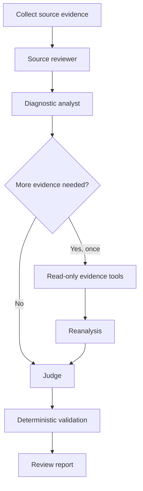

# Agent teams and code navigation

The runtime team is defined in Python.

## Start here

| What to inspect | File relative to `src/doc_understanding/` |
|---|---|
| Team membership and model profiles | `agents/workflows/table_review/profiles.py` |
| LangGraph nodes and execution order | `agents/workflows/table_review/graph.py` |
| Shared graph state | `agents/workflows/table_review/state.py` |
| Entry point for a review request | `agents/workflows/table_review/service.py` |
| Persisted mode → team dispatch | `agents/workflows/registry.py` |
| Prompt, response schema and one-call execution | `agents/role_classifier.py`, `agents/relation_analyst.py`, `agents/relation_judge.py` |
| Source-first review with bounded expansion | `agents/workflows/evidence_review/graph.py`, `agents/source_reviewer.py` |
| Question agent graph (plan → gather → select → answer, one bounded re-search) | `rag/agentic/graph.py` (nodes in `rag/agentic/run.py`) |

Each role owns `ROLE` (name, prompt, response model) and a `run` function. The table
team's `TEAM` tuple registers its three roles. A transport supplied by the service
performs calls and preserves existing cached requests, call reservations and budgets.
Importing a role or compiling a graph does not invoke a model.

`build_graph(...)` in the table team exposes graph assembly separately from evidence
loading and execution. It connects role classification → relation interpretation →
independent judgment → deterministic validation. Classification output is deliberately
excluded from the relation analyst and Judge inputs: calling prose a description must
not suppress its parent/header relationships.

## Source-first review flow



| Persisted mode | Team | Why retained |
|---|---|---|
| `agents_roles` | `agents/workflows/table_review` | Role-independent relationship review and human decision loop |
| `agents_v2` | `agents/workflows/evidence_review` | Source-first analysis with one evidence expansion |
| `agents` | `agents/workflows/legacy_review` | Existing queued requests and explicitly selected legacy review |
| `local` | `validation/source_integrity.py` | Source integrity and saved-data checks without a model |

`agents/workflows/axis_review` remains an explicit source-axis evaluation workflow. These are
different bounded workflows, not simultaneously running autonomous workers. No new
supervisor model or open-ended loop has been added. Results remain unvalidated
candidates; a Judge's agreement never publishes financial facts.

## Responsibilities outside the team

- `tools/`: evidence selection, context expansion and stored relation lookup.
- `validation/`: deterministic citation, coverage, topology and source checks.
- `runtime/`: model transport, configuration, durable queue and call accounting.
- `review/`: original feedback, revisions and human-reference records.
- `services/documents.py`: extraction and saved display snapshots, independent of HTTP.
- `web/`: Folio HTTP routes, document rendering and `static/` browser assets.
- `experiments/parser_repair/`: isolated code-patch experiments and model-free refresh runs.
- `extraction/`, `table_understanding/`, `rag/`: existing parsing/search modules.

Existing extraction API and historical human-review API remain in `api/` and
`review/human/`; their contracts were not merged into Folio.

## Run locally

From the project root after installing the project in the environment:

```powershell
.venv/Scripts/python.exe -B -m doc_understanding.web
```

Open `http://127.0.0.1:8766`. The installed console entry point is `nh-review`.
Existing opt-in review and parser-experiment settings still apply; no paid feature
was activated by the refactor. The application retains `work/document-explorer`
and its existing queue/history paths. `NH_DOCUMENT_ROOT` can explicitly select a
project root when running an installed package outside the source checkout.

The isolated document worker has no HTTP server or review-queue dependency:

```powershell
.venv/Scripts/python.exe -B -m doc_understanding.services.documents INPUT.pdf OUTPUT_DIR
```

All active source imports now use `doc_understanding`, not a root `demo` package.
Browser assets ship in the Python package. Former `demo/test_*.py` tests are collected
by the normal `pytest tests` command; shared fixtures are in `tests/review_fixtures.py`.
Historical reports and frozen source snapshots retain their original paths and text.

## Connected campaign implementation plan (2026-11-04)

The selected campaign pilot now connects deterministic parsing, local checks and
the real specialist review queue. Its first live model attempt failed on DNS.
Parser improvement, evaluation and the final human decision cycle remain unconnected.
Existing parser experiment paths can apply passing patches to the workspace; the
planned campaign must separate candidate generation from final approved promotion.

See [CAMPAIGN_IMPLEMENTATION_PLAN.md](CAMPAIGN_IMPLEMENTATION_PLAN.md) for the
current gaps, exact files to change, target package responsibilities, persistent
execution contracts, evaluation definitions and staged acceptance criteria.
That document distinguishes the full target plan from the first implemented slice.
