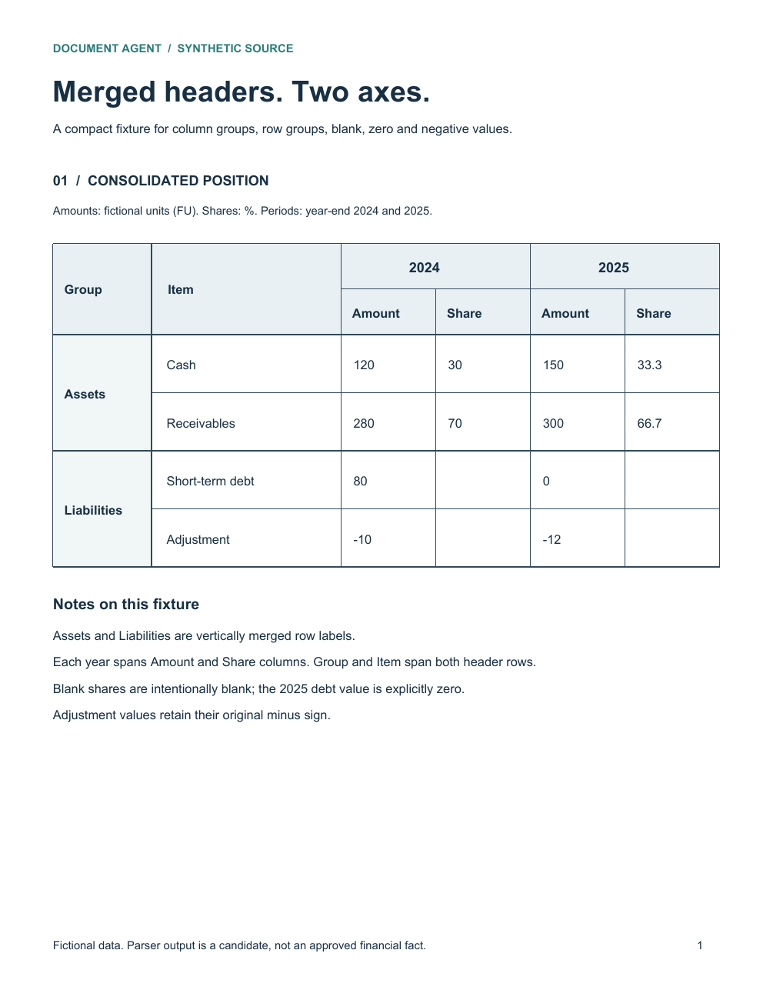
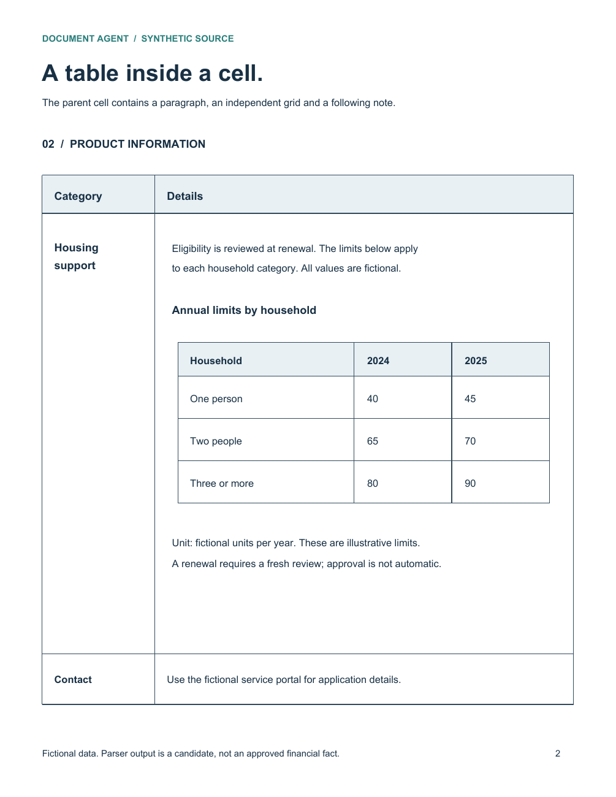

# Complex table showcase: original PDF → actual JSON

이 예제는 병합 셀, 양축 계층, 셀 안 설명문과 내부 표가 실제 코드에서 어떻게 표현되는지 보여줍니다. 금융기관의 실제 자료가 아닌 직접 제작한 가상 PDF입니다. 원본 파서·JSON 계약·검색 로직을 수정하지 않았습니다.

## 1. Merged row and column headers



- `Group` and `Item` each occupy two header rows.
- `2024` and `2025` each span `Amount` and `Share`.
- `Assets` spans `Cash` and `Receivables`; `Liabilities` spans the two debt/adjustment rows.
- Blank shares, numeric zero, and negative amounts remain distinct.

The runtime emits 30 physical cells. Six are merged: four vertical and two horizontal. It maps 16 body values, including blank shares, to both axes. For example, the **actual generated label projection** for `150` contains:

```json
{
  "raw_value": "150",
  "row_path_labels": ["Assets", "Cash"],
  "column_path_labels": ["2025", "Amount"],
  "evidence_state": "inferred"
}
```

The excerpt omits IDs for readability. Full IDs and all 22 paths are in [value-paths.json](../examples/complex-results/value-paths.json). The label projection is a readable inspection view, not a replacement schema or parser input. Raw [PhysicalTableIR](../examples/complex-results/physical/page-001-table-000.json) and [StructuredTableIR](../examples/complex-results/physical/page-001-table-000-structured.json) retain geometry, Tree node IDs, source spans and mapping states.

## 2. A paragraph and a table inside the same cell



The outer table has six cells. Its middle-right cell contains two introductory lines, a caption, an independent 12-cell table, a unit note and a following sentence. The parser preserves the outer grid and inner grid separately.

The actual [nested-content sidecar](../examples/complex-results/nested-content.json) links:

```text
Outer native table /p0002/t0000
  → parent cell /p0002/t0000/c0003
    → introductory paragraph
    → second paragraph
    → caption
    → inner PhysicalTableIR /p0002/physical001
    → unit note
    → following paragraph
```

Only the common document-hash prefix is omitted above. Actual fields report `containment_status: linked`, `coverage_status: complete`, `reading_order_status: total`, with no uncovered, duplicate or outside-parent spans. The inner value `70` is linked to `Two people → 2025`, but its runtime `evidence_state` is **`unresolved`**. Matching the authored fixture does not change that state or enable fact publication.

Inspect the [outer PhysicalTableIR](../examples/complex-results/physical/page-002-table-000.json), [inner PhysicalTableIR](../examples/complex-results/physical/page-002-table-001.json), and [inner StructuredTableIR](../examples/complex-results/physical/page-002-table-001-structured.json). The [full CanonicalDocument](../examples/complex-results/canonical-document.json) includes original text, physical tables and semantic candidates. Containment/order remains in the linked sidecar, rather than being represented as an already-approved semantic parent relation.

## 3. What was actually checked

| Check against the authored source layout | Result |
|---|---|
| Cell bbox, rowspan/colspan, occupied slots | 48/48 |
| Exact text, merged table + inner table | 42/42 |
| Body value mapping, both row and column labels | 22/22 |
| Parent-cell link | 1/1 |
| Parent content span coverage and order | Complete / total |
| StructuredTableIR analysis state | All three remain `partial` |
| API / database calls | 0 / 0 |
| Approved financial facts | 0 |

The six outer-cell strings are not included in the 42 exact-string checks; parent narrative coverage is tested using source-span linkage. This is an authored development fixture, **not independent evidence of general PDF accuracy**. This run demonstrates extraction and references, not live RAG search, embeddings or a GPT-generated answer. Real-document failures remain documented in [EVALUATION.md](EVALUATION.md).

## Reproduce

After installing the project dependencies:

```sh
python examples/complex_demo.py --output demo-output-complex
```

The command runs the existing pipeline first, then performs independent fixture assertions. Expected values never enter extraction, Tree generation, or retrieval. It writes full IR, CanonicalDocument, nested links and inspection projections. The included [summary](../examples/complex-results/summary.json) records the actual published run; IDs and timestamps may vary on rerun.

To recreate the fictional source PDF, install the optional authoring dependency `reportlab` and run `python examples/create_complex_fixture.py`. This generates a development fixture only and does not alter runtime algorithms.
