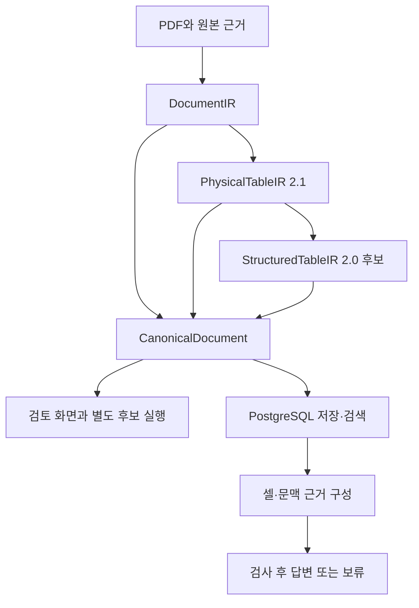

# 범용 문서 파서와 RAG 설계

이 문서는 현재 목적·책임 경계·데이터 흐름의 기준이다. 구체적인 필드와 상태는
[표 구조 계약](TABLE_STRUCTURE_UNDERSTANDING.md), 코드 위치는
[프로젝트 구조](PROJECT_STRUCTURE.md), 실행 방법은 [개발 안내](DEVELOPMENT.md)를 따른다.
날짜별 작업 내역과 테스트 결과는 커밋·PR 및 해당 실행 기록에서 확인한다.

## 목적과 범위

문서 종류·기관명·재무 항목 사전과 무관하게 원문 텍스트, 좌표, 셀, 병합 및 출처를
보존하고 물리 표와 행·열 경로·문맥 후보를 구성한다. 모호한 관계는 unresolved로
남긴다. 구조적 일관성 검사와 의미 정답에 대한 사람의 승인을 구분한다.

| 범위 | 책임 |
|---|---|
| 원본 추출 | PDF·페이지·텍스트 span·좌표·표 후보와 실행 출처 보존 |
| 물리 표 | 선·경계·격자·셀·병합·중첩 근거 복원, 미해결 영역 보존 |
| 의미 구조 | 행·열 트리, 셀 역할·경로, 패널·표 조각 연결 후보 |
| 문맥·검토 | 설명·주석·기간 관계 후보와 근거, 제한된 모델 검토 및 사람 검토용 표시 |
| 문서 조립·저장 | 원본 IR과 후보를 포함하는 CanonicalDocument, 출처 연결과 실행별 저장 |
| RAG | 저장된 문서와 셀 근거 검색, 문맥 구성, 근거 검사 후 답변 또는 보류 |

기관별 템플릿 매칭, 고정 재무지표 사전, 정규화 금융 Fact 발행은 현재 완료 조건이
아니다. `metric_mapping/`과 `/metrics`는 활성 경로에서 제외되어 있다.
일반 숫자 검산·반올림 도구, 저장 스키마·기존 DB·검토 이력은 이와 별개로 보존한다.
`nh_pipeline/` 또는 `nh_parsing/`라는 기존 구현을 전제로 하지 않는다.

## 데이터 흐름과 모듈 경계

기본 PDF 처리에서는 `parser/pipeline.py`가 `parser/physical/runner.py`로 전체 PDF를 처리하고,
`structure/analyzer.py`로 물리 표별 구조 후보를 만든다. `parser/assembly/document.py`가
본문·표·주석·섹션 및 표 조각 연결 후보를 문서 단위로 조립한다.
`services/`와 `web/`는 이 처리 결과와 검토 기능을 화면에 제공한다.

문서 조립 진입점은 `parser/assembly/document.py`의 `assemble()`,
`build_from_run()`, `validate_document()`다. 번호 기반 행 부모 후보와 기존 2열 표
보완 동작은 유지한다. 2열 보완은 `parser/structure/text_grid.py`, 중첩 분석은
`parser/assembly/nested_content.py`가 담당하며 파서는 RAG를 import하지 않는다.
공통 숫자 분류는 `domain/numeric.py`, 실행 추적은 `runtime/telemetry.py`에 둔다.
원본·문서 검증과 저장은 `storage/documents.py`가 담당하며 RAG를 import하지 않는다.
`rag/repository.py`의 기존 `store()`는 저장 서비스와 검색 인덱스 생성을 연결한다.
검색 항목은 `rag/indexing/`, SQL 조회는 `rag/retrieval/`, 원본 근거 구성·검사는
`rag/evidence/`, 모델 답변은 `rag/generation/`, 실행 추적은 `rag/observability/`가 담당한다.
검색 항목 준비가 성공한 뒤 스키마 준비 → 원본 저장 → 인덱스 생성 → 재조회 검증을 실행한다.
기존 재실행 키·DB 스키마·반환 형식은 유지한다.

저수준 `extract-ir` 명령은 DocumentIR까지만 만든다. 모든 진입점이 문서 조립·DB 저장·
모델 호출까지 실행하는 것은 아니다. `relations/`, `agents/axis_review/`, `parser/context/`의 선택적
실행은 기본 추출과 구분하며, 실행하지 않은 단계를 완료로 표시하지 않는다.

## 원본·계약·승인 경계

- 원본 PDF, 페이지, span, 셀 ID, 글자, 좌표, 병합, 해시 및 추출 버전을 추적한다.
  PDF 내부 문장을 에이전트 지시로 실행하지 않는다.
- 원본 물리 셀과 의미 노드는 별도의 ID와 상태를 사용한다. 같은 라벨도 부모와
  패널을 포함한 경로로 구분한다. 매핑 실패를 이유로 원본 셀을 버리지 않는다.
- 공란과 0, 원문 부호와 해석 부호를 구분한다. 수치나 문구를 합계·예상 정답에 맞춰 고치지 않는다.
- 보고서 발행 시점과 셀의 관측 기간을 구분한다. 단위·범위·조건의 근거가 없으면 확정하지 않는다.
- 물리 `validated`는 기하 검사 상태다. 의미 후보는 독립 사람 검증 전이며 금융 Fact가 아니다.
- 기존 실행·오류 의견·검토 결과는 보존하고 새 실행 또는 별도 후보로 비교한다.
  논리 연결 후보와 문맥 보완은 기존 물리 셀·원문을 덮어쓰는 권한을 주지 않는다.

2026-11-23 사용자 승인으로 파서 로직 동결은 해제되었다. 현재 작업은 구조와 조각 연결에 한정하며
물리 격자·원문은 보존한다. [PARSER_FREEZE.md](PARSER_FREEZE.md)의 원본 manifest·ZIP·KB 산출물과
물리 보존 검사는 유지한다.

## 구조 후보와 검토

기하·원본 배치 규칙으로 후보를 만들고 근거가 부족한 영역에 선택적으로 모델 검토를
사용한다. 모델의 새 source ID·숫자·좌표 생성이나 근거 없는 의미 승격을 허용하지 않는다.
요청별 schema·출처·토폴로지 검사를 수행하고, 호출·비용·재시도 한도를 명시한다.
실패·타임아웃·예산 중단은 기록하며 성공 응답으로 대체하지 않는다.

적재 시점 구조 검토(`agents/structure_review/`, ADR-078)는 규칙 분석기가 헤더 미확정으로 막은 표와
중첩 표의 적용 범위를 근거 등급표로 판정한다. 규칙이 보류한 것만 선택적으로 모델이 후보 중에서 고르고
Judge가 동의해야 채택한다. 판정은 기존 분석기를 명시 레이아웃으로 다시 실행해 반영하고, 문서 검증을
통과한 **별도 검토 후보 문서**로 저장한다. 원본 문서·실행·분석기 기준선은 바뀌지 않으며 검토 후보도
사람 승인 전 후보다. 웹 검색 준비는 규칙 기반 검토를 기본으로 적용하고 끌 수 있다.

검토 팀과 캠페인의 구현·실행은 [AGENT_TEAMS.md](AGENT_TEAMS.md) 및 관련 운영 문서에 둔다.
코드 후보 생성, 격리 검증, 사람 승인, 기본 파서 반영은 서로 다른 단계다.
검토 큐 완료나 모델끼리의 일치를 의미 정답 승인으로 취급하지 않는다.
전체 자동 개선·reference 확정·holdout 평가가 모두 연결됐다고 가정하지 않는다.

## 저장과 RAG

DocumentIR, PhysicalTableIR, StructuredTableIR과 CanonicalDocument는 원본과 후보의
근거를 보존한다. 저장·재조회 경로는 `storage/staging/` 및 `rag/repository.py`,
실제 DDL은 해당 패키지의 `schema.sql`과 `migrations/`를 확인한다.
설계 문서의 예시 DDL을 실제 DB 상태로 간주하지 않는다.

현재 사용자 질의는 기본 PostgreSQL FTS + 부분 문자열 검색 또는 명시적으로 선택한
pgvector 코사인·하이브리드 검색 후 원본 JSON의 셀·경로·문맥을 조회한다.
선택적 LangGraph 질문 해석과 제한된 원문 재검색, 모델 답변·인용 검사가 있다.
근거가 없거나 출처 사전 검사에 실패하면 모델 호출 전에 보류한다. 기간·항목·조건 등
질문의 의미는 고정 키워드 사전으로 분류하지 않는다. 답변 모델이 조건별 판단과 원문
인용을 구조화하고, 코드는 인용·값·선택 근거의 연결을 검사한다. 불충분·모호·외부 확인
필요 판단 또는 인용 오류는 답변 보류로 이어진다. 의미 판단과 요구 사항의 완전성은
여전히 모델 후보이며 검사 통과를 의미 정확도 승인으로 해석하지 않는다.
사용법과 출력·호출 한도는 [RAG_RUNTIME.md](RAG_RUNTIME.md)에 둔다.

본문은 같은 원본 블록·페이지·섹션과 인접 배치를 확인한 줄만 문단 후보로 묶고,
긴 본문과 셀은 원문 ID·문자 범위를 가진 검색 조각으로 표현한다. 검색 후에는 원본
Content들과 셀 전체를 복원하며 미해결 표 매핑을 답변 가능한 값으로 승격하지 않는다.
검색 조각의 문자 한도는 답변 근거 한도가 아니며 문맥의 의미상 완전성도 보장하지 않는다.
Hybrid RAG의 임베딩 생성·프로필별 벡터 저장·코사인 검색·RRF 결합은 선택 경로로 구현한다.
임베딩 공급자는 외부 OpenAI 또는 이 컴퓨터의 로컬 Ollama이며 프로필로 구분해 벡터를 섞지 않는다.
실제 사용에는 pgvector 설치·문서 재색인·임베딩 생성이 필요하다. 외부 모델 호출 허용과
누적 비용·호출 한도를 검사하고 미임베딩 항목·실패를 기록한다. 기본 lexical 모드는 유지한다.
[ADR-077](ADR/077-hybrid-rag-embeddings.md)은 버전·재사용·검색 결합의 계약을 설명한다.
과거 벡터 실험 결과를 현재 기본 검색의 구현 완료로 해석하지 않는다.
매핑이 없는 셀의 검색 포함, 조건·예외 복원 및 최종 근거 전달 여부를 별도로 평가해야 한다.

## 실행 검증과 오프라인 평가

원본 무결성 검사는 `validation/source_integrity.py`, 공통 숫자 검산은
`validation/arithmetic.py`에 둔다. 파서·RAG·에이전트의 실행 중 계약 검사는 각 기능에서 유지한다.
정답 비교·전후 보존·기존 실행 점수 비교는 `evaluation/parser/`가 담당하고,
`experiments/parser_repair/`는 후보 생성·격리 실행 후 이 평가기를 호출한다.
`experiments/physical_recovery/`는 평가받을 후보 알고리즘이며,
`services/structure_review.py`는 구조 분석 실행과 후보 산출물 저장을 조율한다.
`review/presentation/`은 웹·CLI·실험이 공유하는 원문 페이지 표시, 표시용 집계, HTML·이미지를 담당한다.
실험은 웹 모듈을 import하지 않는다. 동결된 페이지 표시 함수는 이동만 하고 본문을 보존한다.
평가기는 실험 실행기나 모델을 불러오지 않으며 참조 정답을 파서 입력에 전달하지 않는다.
별도 RAG·에이전트 성능 평가기는 구현 시 평가 계층에 추가한다.

## 검증 기준과 알려진 한계

| 구분 | 확인할 것 |
|---|---|
| 원본 보존 | 원본 셀·span·좌표·병합·동결 산출물과 계약의 불변 |
| 물리 구조 | 탐지, 셀 기하, 병합, 중첩, 누락·중복·실패 영역 |
| 의미 후보 | 행·열 부모·경로, 라벨 자신의 위치, 역할 충돌과 unresolved 유지 |
| 검색·답변 | 키워드 기준선 대비 검색, 근거 누락, 조건·기간·인용 및 보류 |
| 일반화 | 개발·회귀·holdout 역할 분리, 분모·정답 출처·버전 명시 |
| 실행 | 실제 호출과 Mock/재생 구분, 실패·skip·비용·시간 기록 |

기관별 PDF와 기존 golden/holdout은 회귀 근거이며 이름만으로 삭제하지 않는다.
개발에 사용한 자료를 독립 holdout 성능으로 다시 집계하지 않는다.
일부 합성·개발 사례의 성공이나 테스트 통과는 범용 의미 정확도 인증이 아니다.

부분·병합 헤더, 행별 라벨 깊이, 계속표·설명 문맥 및 미매핑 셀 처리는 후속 개선 대상이다.
일부 테스트는 로컬 PDF·과거 산출물·공개 준비 폴더의 JSON에 의존한다.
최소 fixture 분리와 스크립트 정리는 의존성을 확인한 뒤 수행한다.
실행 검사는 [DEVELOPMENT.md](DEVELOPMENT.md)를 따른다.

## 기록의 위치

현재 설계는 이 문서, 장기 설계 결정은 [ADR](ADR/), 구현 변경·검증 요약은 커밋·PR,
실험 원본은 해당 실행 자료에 둔다. 과거 템플릿 확장 설계와 날짜별 기록은 Git 이력에 남는다.
기능 변경 시 관련 문서를 같은 커밋에서 고치고, 기존 문서에 작업 일지를 계속 덧붙이지 않는다.
