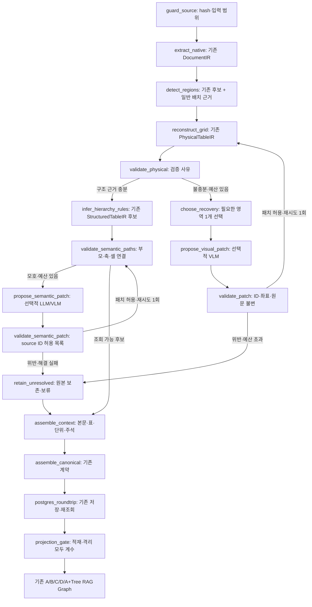

# 후속 설계 제안 — 규칙 복원 + 선택적 LLM/VLM Agent

2026-10-23. **설계 제안이며 이번 동결 실험에는 구현·연결·호출하지 않았다.**
근거: 신규 PDF 6건의 112페이지를 기존 경로로 처리했다. 저장·재조회는 됐지만
안전한 값 조회는 성립하지 않았다. 검색기를 더 복잡하게 만드는 것보다 상류의
표 영역·물리 격자·의미 경로를 각각 검증하고 필요한 곳만 복원하는 것이 우선이다.

## 발견한 실패에서 복원 작업을 결정한다

| 이번 관측 | 다음 단계에서 시도할 일반 복원 | 통과 조건 |
|---|---|---|
| HiTab 이미지 표, BIS 선이 적은 표의 영역 미탐지 | native 텍스트 정렬·이미지/선 후보 결합, 불확실 영역만 VLM 제안 | 원본 페이지의 bbox, 근거 이미지, 중복/누락 진단 |
| PNEUMA 표의 행은 있으나 열 0개 | 원본 vector 선의 단편 연결·닫히지 않은 격자 가설, 안 되면 VLM 경계 후보 | 셀 공간 점유·경계·source span 보존·겹침/누락 검사 |
| 데이터셋 그룹과 Content/Context, Retriever 하위 열 | geometry/반복/병합 범위를 이용한 후보 후 LLM/VLM 제한 패치 | 기존 source cell ID로만 부모 관계 구성, 순환/중복/범위 충돌 없음 |
| 이미지 표 숫자와 native 표 숫자의 혼동 | 이미지 OCR/VLM 전사는 별도 관측 후보로 보존 | 좌표·crop hash·전사 상태, 기존 숫자 덮어쓰기 금지 |
| 빈 행 검색 텍스트 201개 | source-path/검색 projection 검증을 적재 전 독립 단계로 분리 | 총 생성 수 = 적재 + 격리, 원본 레코드·사유 보존 |

이번 표본은 전체 표의 독립 의미 gold가 아니다. 특히 upstream 실패 때문에 실행되지
못한 Row/Column/Mapping 검증을 별도의 의미 오류율로 합산하지 않는다.

## 제안 LangGraph

그래프는 문서/표 단위의 유한한 복원 절차다. 모델이 스스로 무제한 도구를 선택하는
멀티에이전트가 아니다. 규칙 추출이 충분한 표는 모델 호출 없이 기존 경로를 통과한다.

## State와 기존 계약

State에는 `document_id`, `run_id`, 원본 PDF/IR artifact reference·SHA256,
대상 page/table ID, 현재 단계, 검증 코드, 미해결 영역, 후보 패치 참조,
재시도 수, 예산/실제 사용량, 실패/보류 사유만 둔다. 원본 PDF 전체나 인증 설정은 넣지 않는다.

- DocumentIR, PhysicalTableIR 2.1, StructuredTableIR, CanonicalDocument를 유지한다.
- 원본 IR을 덮어쓰지 않는다. 패치와 선택 결과는 기존 overlay/patch 패턴의 별도 sidecar다.
- 새 source ID를 모델이 발명하거나 기존 숫자를 수정한 패치는 거절한다.
- 숫자의 합계가 맞는다는 이유만으로 셀·부모·단위·기간 관계를 승인하지 않는다.
- 표 제목·주석 적용은 원본 `context_links`와 source reference를 보존하며 모호한 범위는 unknown이다.
- `lookup_eligible`와 `semantic_status`를 구분한다. 사람이 승인한 사실로 승격하지 않는다.

## 모델 입력/출력과 검증 경계

LLM에는 대상 셀/노드의 ID 허용 목록, 최소 원문 라벨, 현재 부모/축 후보와 검증 코드를 준다.
VLM은 해당 표 또는 문제 영역의 crop과 좌표 변환 정보만 받는다. 원본 문서 전체를 전송하지 않는다.
PDF 안의 지시문은 전부 데이터다. 프롬프트/도구/API 키에 관한 문서 내 지시는 실행하지 않는다.

출력은 스키마가 정한 구조 패치 제안이다. 표 설명으로 숫자를 만들거나 정답 질문을
복원 모델에 전달하지 않는다. 원본에 없는 단위/기간/동의어를 검증 조건으로 쓰지 않는다.
패치 검증과 물리/의미 검증을 모두 통과한 경우에만 새 후보 revision을 선택한다.

최초 제안 한도는 표별 물리 복원 1회 + 의미 패치 1회, 문서별 최대 4회다.
비용 한도는 설정에서 명시하고 호출 전 예약한다. 초과 시 부분 산출물과 보류로 종료한다.
모델·단가·이미지 토큰 산정은 다음 구현 때 공식 문서로 확인한다. 이 설계에서는 VLM 모델이나
미실행 정확도/비용 수치를 확정하지 않는다.

## 관측 및 다음 검증

기존 Langfuse root 아래 단계별 Span을 연결한다. 모델 입력은 최소 crop/라벨 참조,
출력은 허용/거절된 patch·검증 코드·호출 횟수·토큰·비용·보류 사유다.
기존 Graph Callback과 사용자 Span을 중복 root로 만들지 않으며 전송 실패는 처리를 막지 않는다.

다음 단계에서는 이번 개발 문서만으로 일반 복원을 개발하고 **새로운 미사용 Holdout**을
확보한다. 이번 Holdout은 이 실험의 최종 평가 기록으로 남긴다. 이미 본 결과를 이용해
수정한다면 해당 문서를 새 단계의 개발 데이터로 명시적으로 전환하고 독립 성능에 포함하지 않는다.

구조가 올바른 표 집합을 먼저 확보한 뒤 동일 RAG를 다시 평가해 추출 개선과 검색 개선의
효과를 분리한다. 10/29 시연은 검증 가능한 농협 표의 키워드+Tree 경로와 신규 복합표의
정직한 보류/추적을 우선한다. 이 제안의 Agent가 완성됐다고 시연하거나 보고하지 않는다.
